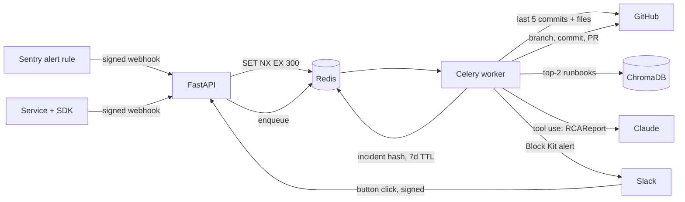
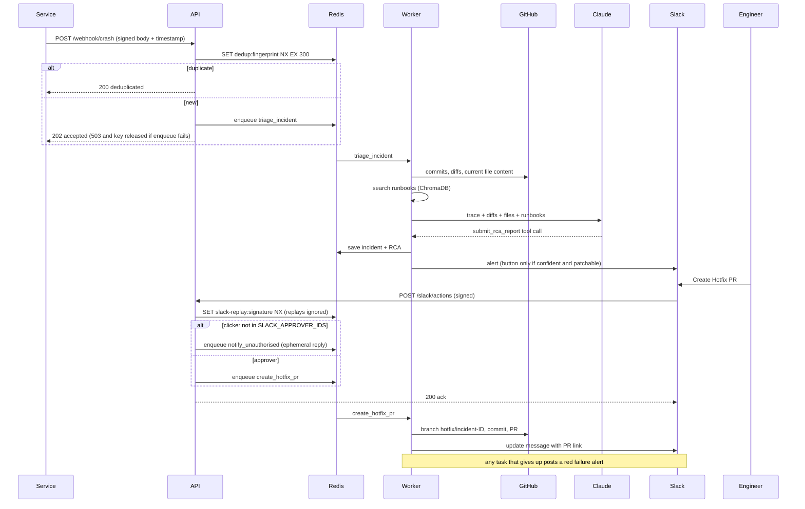

# Auto-OnCall 🚨

[](https://github.com/HNTRHACK/auto-oncall/actions/workflows/ci.yml)

Event-driven incident triage and root-cause analysis. A service crashes; Auto-OnCall
deduplicates the report, correlates the stack trace with recent commits and past runbooks using
Claude, posts a Slack alert, and opens a hotfix PR **only after an engineer clicks the button**.

**Stack:** FastAPI · Celery · Redis · PyGithub · Slack Block Kit · Claude API · ChromaDB · Docker

**Plugs into what you already run:** point a [Sentry](#connect-sentry) alert rule at it, or add
two lines of the bundled [Python SDK](#report-from-python-without-sentry) to any service.

## Architecture





## Quickstart (dry run: no API keys, no external calls)

`DRY_RUN=true` is the default. GitHub returns canned data, a deterministic fake replaces
Claude, and the Slack JSON and PR diff are printed to the worker log. Needs Docker Compose
2.24 or newer.

```bash
docker compose up -d --build --wait
docker compose exec worker python scripts/seed_runbooks.py
docker compose exec api python scripts/simulate_crash.py --approve
docker compose logs worker          # Slack blocks and PR diff
docker compose down
```

`simulate_crash.py` sends a signed crash, sends it again (deduplicated), and with `--approve`
clicks the PR button twice (one PR). A rerun within 5 minutes is deduplicated entirely.

If `docker compose build` fails in Git Bash on Windows with
`additional privileges requested`, run it from PowerShell.

### Local development

```bash
uv sync --extra dev                        # reproducible install from uv.lock
# or: python -m venv .venv && .venv/Scripts/python -m pip install -e ".[dev]"   # Linux/macOS: .venv/bin/python
cp .env.example .env
docker run -d -p 127.0.0.1:6379:6379 redis:7

.venv/Scripts/python scripts/seed_runbooks.py
.venv/Scripts/python -m celery -A app.worker.celery_app worker --pool=solo --loglevel=info   # terminal 1
.venv/Scripts/python -m uvicorn app.main:app                                                 # terminal 2
.venv/Scripts/python scripts/simulate_crash.py --approve                                     # terminal 3

.venv/Scripts/python -m pytest             # offline; no Redis or keys needed
.venv/Scripts/python -m ruff check . && .venv/Scripts/python -m ruff format --check .
.venv/Scripts/python scripts/eval_rca.py
```

`--pool=solo` is required on Windows; omit it elsewhere.

## Connect Sentry

If your crashes already go to Sentry, nothing changes in your services.

1. In Sentry: **Settings → Developer Settings → Custom Integrations → Create New Integration →
   Internal Integration**.
2. **Webhook URL:** `https://<your-host>/webhook/sentry`. Turn on **Alert Rule Action**.
   Permissions: Issue & Event → Read.
3. Save, copy the **Client Secret** into `SENTRY_CLIENT_SECRET`, restart the API.
4. **Alerts → Create Alert → Issues:** e.g. "a new issue is created" in production, action
   "Send a notification via *your integration*".

What the adapter does:
- Verifies `Sentry-Hook-Signature` (HMAC-SHA256 of the raw body with the client secret).
- Takes the finally-raised exception, keeps your app's frames (`in_app`), and reverses Sentry's
  oldest-first order so the raising frame is first.
- Service name comes from a `service` tag (`sentry_sdk.set_tag("service", "payments-api")`),
  else the project. Environment from the event.
- Remembers Sentry event ids for the incident TTL. The Sentry signature has no timestamp, so this
  is what stops a replay after the 5-minute dedup window.
- Answers fast and returns **500** (never 503) when it cannot enqueue: Sentry does not retry
  503/504 and disables integrations that keep failing. Non-crash resources get `200 ignored`.
- The Slack alert links back to the Sentry issue.

## Report from Python (without Sentry)

`auto_oncall_client` is a single, standard-library-only module in this repo. Vendor it (copy the
folder) or install the project, then:

```python
import os, auto_oncall_client

auto_oncall_client.init(
    url="https://oncall.example.com",
    secret=os.environ["AUTO_ONCALL_SECRET"],   # the server's WEBHOOK_SECRET
    service="payments-api",
    environment="production",
)
```

Every uncaught exception (main thread and threads) is reported. For handled errors use
`auto_oncall_client.capture_exception()` in an `except` block, or attach
`auto_oncall_client.AutoOnCallHandler()` to a logger so `log.exception(...)` reports. Paths are
made relative to the working directory (pass `root=` if your repo root differs) so they match
repository paths; library frames are dropped. Reporting never raises, handled errors are sent
from a background thread, and only `https://` (or localhost) URLs are accepted.

## API

| Endpoint | Auth | Responses |
|---|---|---|
| `POST /webhook/crash` | `X-Webhook-Timestamp: <unix seconds>` and `X-Signature-256: sha256=<HMAC-SHA256 of "<timestamp>.<raw body>">`; timestamp within 5 minutes | 202 accepted, 200 deduplicated, 401, 413, 422, 503 |
| `POST /webhook/sentry` | `Sentry-Hook-Signature` (HMAC-SHA256 of raw body, key `SENTRY_CLIENT_SECRET`) | 202 accepted, 200 deduplicated / duplicate_event / ignored, 401, 422, 500 |
| `POST /slack/actions` | Slack v0 signature, timestamp within 5 minutes; approve only for `SLACK_APPROVER_IDS` | 200 (also for ignored replays and unauthorised clicks), 400, 401, 503 |
| `GET /health` | none | 200, or 503 if Redis is down |
| `GET /metrics` | none (scrape from inside your network) | Prometheus text format, or 503 if Redis is down |

Signing a crash report (any language works the same way):

```python
import hashlib, hmac, json, time
body = json.dumps(report).encode()
ts = str(int(time.time()))
sig = "sha256=" + hmac.new(SECRET.encode(), ts.encode() + b"." + body, hashlib.sha256).hexdigest()
headers = {"X-Webhook-Timestamp": ts, "X-Signature-256": sig, "Content-Type": "application/json"}
```

Webhook body (`stack_trace[0]` must be the **top** frame, where the error was raised; Python
tracebacks list it last, so reverse them):

```json
{
  "service_name": "payments-api",
  "environment": "production",
  "error_type": "AttributeError",
  "error_message": "'NoneType' object has no attribute 'email' (order 48213)",
  "stack_trace": [{"filename": "/srv/app/payments/processor.py", "lineno": 7, "function": "charge"}],
  "timestamp": "2026-01-01T12:00:00Z"
}
```

## Environment variables

| Variable | Default | Purpose |
|---|---|---|
| `DRY_RUN` | `true` | Fake GitHub, Claude, Slack and embeddings |
| `LOG_LEVEL` | `INFO` | Log level (JSON lines) |
| `REDIS_URL` | `redis://localhost:6379/0` | Broker, dedup keys, incidents (Redis 7+) |
| `WEBHOOK_SECRET` | empty (rejects all) | HMAC key for crash webhooks |
| `SLACK_SIGNING_SECRET` | empty (rejects all) | Verifies Slack interactions |
| `SENTRY_CLIENT_SECRET` | empty (rejects all) | Client Secret of the Sentry internal integration |
| `SLACK_BOT_TOKEN` | empty | `xoxb-` token with `chat:write` |
| `SLACK_CHANNEL` | `#oncall` | Alert channel |
| `SLACK_APPROVER_IDS` | empty | Comma-separated Slack user IDs allowed to create hotfix PRs. Empty: anyone in `DRY_RUN`, **nobody** in live mode |
| `GITHUB_TOKEN` | empty | Contents and Pull requests: read and write |
| `GITHUB_REPO` | empty | `owner/name` of the monitored repository |
| `GITHUB_BASE_BRANCH` | `main` | Branch to analyse and target |
| `ANTHROPIC_API_KEY` | empty | Claude API key |
| `ANTHROPIC_MODEL` | `claude-sonnet-5-5` | Model for analysis |
| `CHROMA_PATH` | `.chroma` | Runbook vector store |
| `PR_CONFIDENCE_THRESHOLD` | `0.6` | Minimum confidence for the PR button |
| `DEDUP_TTL_SECONDS` | `300` | Dedup window |
| `INCIDENT_TTL_SECONDS` | `604800` | Incident retention; the button stops working after this |
| `MAX_DIFF_CHARS` | `4000` | Per-file diff truncation |
| `MAX_FILE_CHARS` | `60000` | Larger files are not sent to Claude or patched |

## Going live

1. Replace both dev secrets in `.env` with random values. Do this before exposing the port.
2. **GitHub:** a fine-grained token limited to the one repository (Contents and Pull requests:
   read/write). Protect `main` and require review.
3. **Slack:** create the app from [`slack-app-manifest.yml`](slack-app-manifest.yml)
   (api.slack.com/apps → Create New App → From an app manifest; replace `YOUR-HOST`). It sets
   the `chat:write` scope and the Interactivity URL. Install it, invite the bot to the channel,
   and copy the bot token and signing secret. Put the Slack user IDs of people allowed to approve hotfixes in
   `SLACK_APPROVER_IDS` (profile → ⋮ → Copy member ID); with it empty, nobody can.
4. **Claude:** set `ANTHROPIC_API_KEY`.
5. Set `DRY_RUN=false`, re-run `seed_runbooks.py` (live mode uses a different collection and
   Chroma downloads its embedding model on first use), and restart the API and worker.
6. Put the API behind TLS. Compose publishes ports on localhost only.

Live mode sends stack traces, error messages, diffs and source files to the Claude API. Check
that this is acceptable for your code and that crash messages carry no customer data.

## Trade-offs

### Redis `SET NX` vs database unique constraints
One atomic `SET NX GET EX` deduplicates in a round trip, expires by itself and returns the
original incident id. The price: it is only as durable as Redis, and eviction or failover can
let a duplicate through. A unique constraint on `(fingerprint, time_bucket)` is durable and
auditable but needs a database, cleanup, and handling of bucket boundaries. A rare duplicate
alert is tolerable here, so Redis wins. Known gaps: a duplicate arriving while the first
request is failing to enqueue is told "deduplicated" although nothing was queued (the sender
should keep reporting), and the fingerprint ignores `environment`, so identical staging and
production crashes merge.

### At-least-once delivery and idempotency
Tasks use `acks_late`, so a killed worker's task is redelivered rather than lost. Every task
can therefore run twice:

- Triage skips if the alert is already posted and reuses a saved RCA instead of paying for a
  second one. A crash between posting to Slack and saving the timestamp can still double-post.
- Hotfix creation has a Redis lock, a stored `pr_url`, and GitHub-side checks (existing PR,
  branch, commit), so it resumes after partial failure and creates one PR.

### Retries and rate limits
Network errors, 429s, 5xx and GitHub rate-limit 403s retry up to 5 times with jittered
exponential backoff, never earlier than `Retry-After` or `X-RateLimit-Reset`. SDK-level retries
are disabled for GitHub and Claude so a worker never sleeps while holding a slot. Other errors
fail immediately. The Redis visibility timeout (2h) exceeds GitHub's hourly reset so delayed
retries are not redelivered early. After the last retry, or at once on a permanent error such as
a bad token, the task posts a red **"triage failed" / "hotfix failed"** alert to Slack with the
incident id and last error, marks the incident failed, and bumps a counter. Alerting is best
effort: if Slack itself is the failure, the error is logged and the original exception still
propagates. Keep a basic pager on your error tracker as the last line of defence.

### Replay protection
- **Crash webhooks** are signed over `<timestamp>.<body>` (the Stripe scheme) and rejected
  outside a 5-minute window. A captured request cannot be re-sent later, and changing the
  timestamp breaks the signature. Inside the window an exact replay is a duplicate, which the
  fingerprint already dedups, so no extra nonce store is needed (keep `DEDUP_TTL_SECONDS` at or
  above 300 for this to hold).
- **Slack interactions** have the same 5-minute window, and Slack never resends a click, so a
  second request with an already-seen signature is a replay: it is acknowledged (so Slack shows
  no error) and dropped. The key is released if enqueueing fails, so a genuine retry gets through.
- Hotfix creation is idempotent anyway; replay protection stops duplicated work and noise, not
  duplicate PRs.

### Why a human approves the PR
The model can be wrong with a plausible explanation, and a bad automated "fix" during an
incident makes it worse. The button creates a normal PR; merging still goes through review and
CI. Only Slack users listed in `SLACK_APPROVER_IDS` can trigger it; anyone else gets an
ephemeral "not authorised" reply and nothing happens. The check runs server side on the signed
user id, so hiding the button is not the only guard. An empty list fails closed in live mode.

### Hallucination risk and confidence gating
- The report must match a strict tool schema and pass Pydantic validation; the commit must be
  one that was fetched and the file one that was provided. One retry, then a zero-confidence
  fallback.
- The commit author comes from GitHub, never from the model.
- No button below the threshold, for no-op patches, or for `.github/` files.
- A full-file patch is refused if the file changed on `main` since triage.
- Before the button is shown, the patched file is **parsed, never executed**: Python must still
  parse (`ast.parse`), JSON/TOML must load, and a "fix" that drops more than half of the
  original lines is refused as a rewrite. The Slack alert says why no PR was offered. This is a
  floor, not CI: it catches broken patches, not wrong ones.
- Crash data is untrusted (prompt injection): it is delimited in the prompt, escaped in Slack,
  and cannot choose a file outside the recently changed ones.

Self-reported confidence is **not** a calibrated probability. It filters weak answers; it does
not make strong ones true.

### Other limits
- Only files changed in the last 5 commits can be patched, and the bug must be among those
  commits to be found.
- Claude rewrites whole files, which costs tokens and can introduce unrelated edits: read the
  diff.
- The approver allowlist is static config; a real deployment would map it to an on-call
  rotation or a Slack user group.
- `eval_rca.py` in dry-run mode scores the fake heuristic (a pipeline check). Only
  `DRY_RUN=false` measures Claude, and 10 synthetic cases are a smoke test, not a benchmark.

## Observability

`GET /metrics` exposes Prometheus counters: `webhook_rejected`, `incidents_accepted`,
`incidents_deduplicated`, `triage_completed`, `triage_failed`, `hotfix_prs_created`,
`hotfix_failed`, `hotfix_unauthorised`, `slack_replays_rejected` (each `auto_oncall_<name>_total`).
They live in one Redis hash rather than in-process `prometheus_client` counters because the API
and each Celery worker are separate processes; any API replica can serve the cluster-wide totals.
Counting is best effort and never fails a request. Logs are JSON lines with `incident_id` on
every event, so one incident can be followed across API and worker.

## CI

GitHub Actions runs ruff (lint + format check) and the test suite on Python 3.11 and 3.12 from
the locked dependencies (`uv sync --frozen`), and builds the Docker image.

## What I'd add at scale
- **Kafka** (or similar) for ingestion: partitioning by service, replay, back-pressure.
- **Dead-letter queue** for tasks that gave up, so they can be inspected and replayed (today
  they raise a Slack alert and are dropped).
- **RCA eval set** from real resolved incidents, run on every prompt or model change, with
  confidence calibration.
- **Latency and cost metrics:** time-to-alert histograms, retries, token cost per incident, PR
  merge rate; OpenTelemetry tracing across API and worker.
- A durable incident database, per-service repository routing, on-call-rotation approvers,
  and running the project's own test suite against the patch in a sandbox before offering it.
- SDKs for Node/Go/Java, or adapters for Datadog, Rollbar and GlitchTip webhooks.
